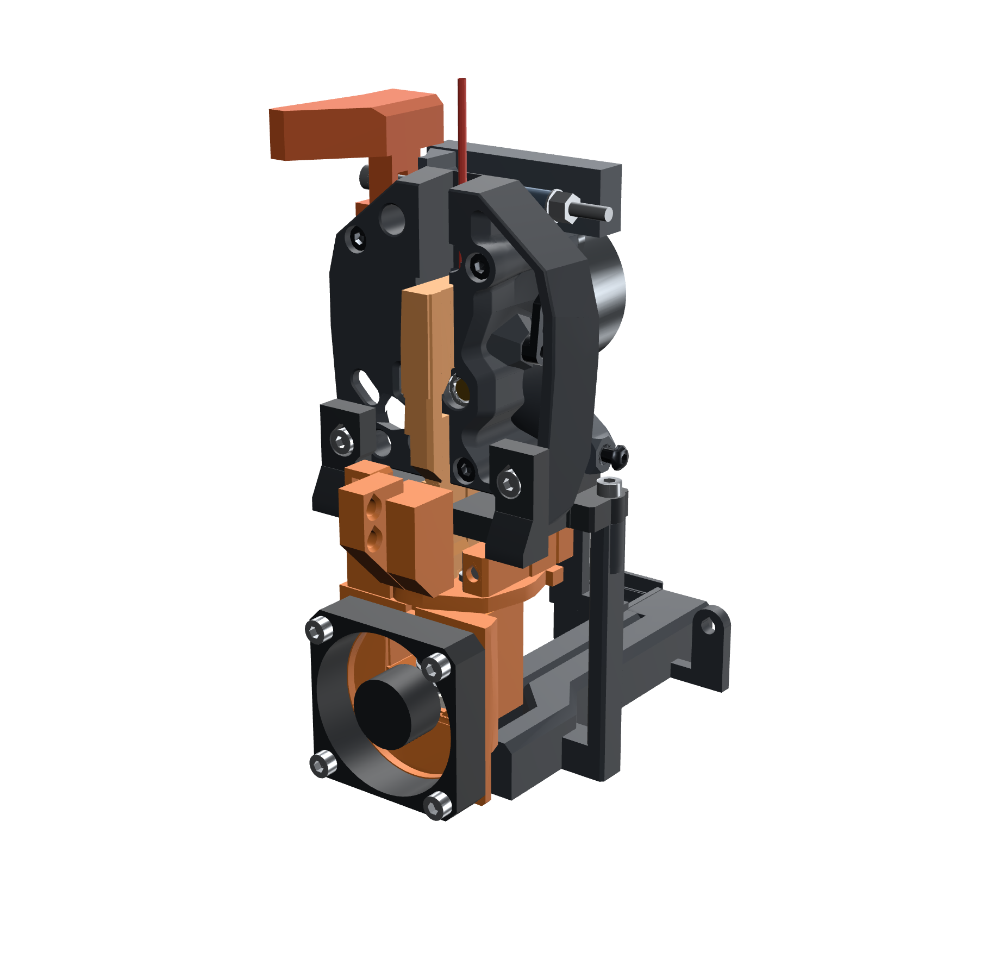
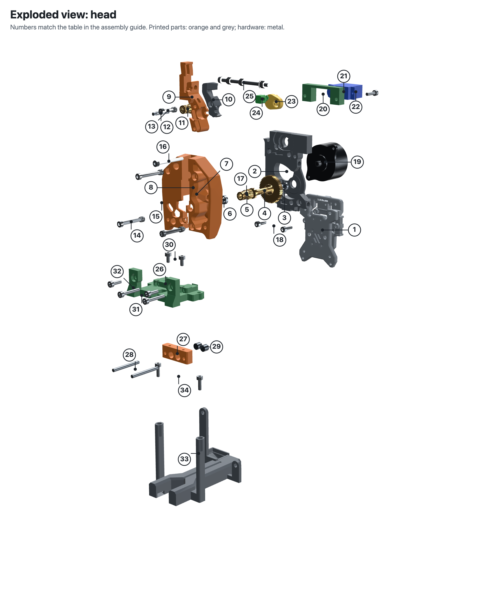
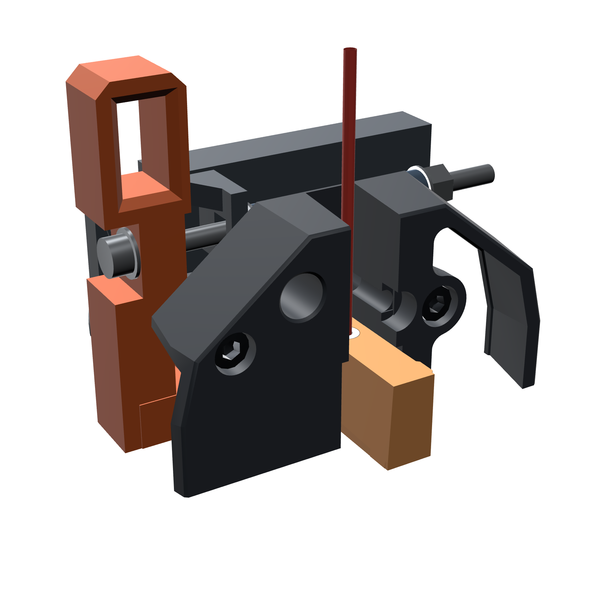
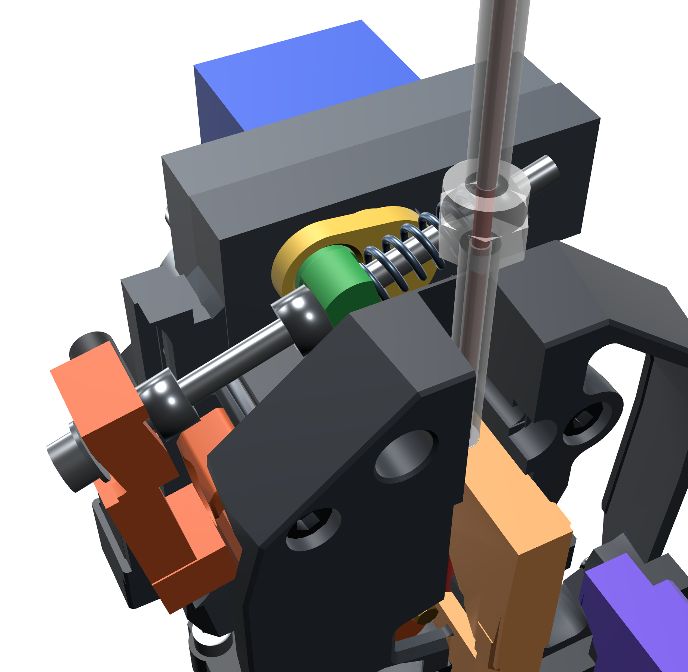
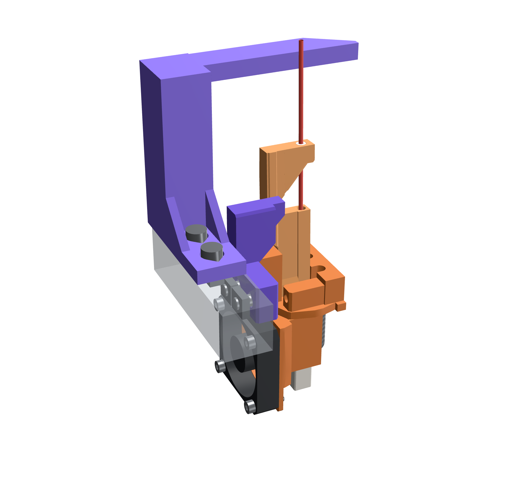

# Voron Shuttlechanger

A hotend-only toolchanger for the Voron Trident, inspired by MedusaHC.

**The extruder stays on the head; only the hotends change.** Each tool is a hotend, a 4010 fan and a small printed tool top. The tool hangs on two hardened pins and is held by magnets.

The extruder is a stock Clockwork 2 (CW2) with an LDO-36 motor, on a CNC Tap V2. A micro servo turns a small **crank** that works a **pull rod** on Guidler A. One half-turn of the crank does three things:
- sets the filament tension when the idler is closed
- takes the spring load off before opening
- pushes the idler open, so the filament can leave the drive gears during a tool change

The tension is set by turning one nut. When closed, the crank sits just past dead centre, so the spring holds it shut with the servo switched off.



> **Status: prototype (v30.10).** The design passes automated collision, printability, wall-thickness and load-case checks. It has **not been printed or tested on a printer yet.** Expect changes.

**Building one? Start with the [illustrated assembly guide](docs/ASSEMBLY_GUIDE.md)**: exploded views, the full hardware list and every step, from the CW2 bearings to the docks. The whole head is built on the bench and then bolted to the Tap in one piece.



## Interactive 3D viewer
`docs/index.html` is a self-contained three.js viewer of the head, tool and dock. It shows all the hardware and has:
- a tool-change animation
- an opener-only slider
- see-through and section-cut views
- an expandable bill of materials (click a row to isolate the part)

Open the file in a browser, or turn on GitHub Pages for the `docs/` folder.

| Opener closed (crank over centre, spring loaded) | Opener open (spring unloaded, idler pushed open) |
|---|---|
|  |  |

## How it works
- **Tool mount:** the head carries 2 Ø3×30 dowels and 4 Ø6×2.65 magnets. Each tool top has matching bores and 2 magnets.
- **Filament path:** the filament runs through a printed Ø3.0 bore in the tool top and a tilting guide lever, up to the drive gears.
- **Dock:** the tool slides 9 mm along X onto 2 Ø3 steel pins on the dock, which hold it while the head backs away in Y. The same shift tilts the guide lever so the filament clears the gears. Docks sit on a 2020 rail at a 63 mm pitch.
- **Opener:** everything sits in the gap between the CW2 body and the motor plate, above the guidler latch.
  - **Servo and crank:** the servo lies flat behind the plate, above the LDO-36, and its spline comes through the plate into the crank.
  - **Pull rod:** an M3×55 runs from a mast on Guidler A, through a trunnion on the crank, to the stock CW2 spring and a tension nut.
  - **Opening:** in the first ~50° of crank travel the spring unloads. A stop nut then catches the trunnion and the rod pushes Guidler A open by 11.4°.
  - **Travel:** 166° of servo rotation. Peak load is about 25 N·mm, about one sixth of what an FS90 makes.
  - **Holding:** closed, the crank sits 6° past dead centre against a stop in the plate, so the spring holds it closed with no power.
  - **Size:** compared with v29, the head is about 17 mm narrower on the left, both open and closed. The top of the plate is 2.7 mm higher.
- **Hotends:** Trianglelab TZ-V6 3.0 or Phaetus Dragon HF, each with its own 4010 fan shroud.



## Repository layout
| Path | Contents |
|---|---|
| `stl/` | Print-ready STLs for every printed part, including the one stock CW2 part (02b), already in print orientation, no supports needed |
| `step/` | STEP (AP214) versions of every part, converted from the meshes: faceted solids, good for measuring and remixing |
| `BOM.csv` | Full bill of materials (per head and per tool) |
| `docs/ASSEMBLY_GUIDE.md` | Complete illustrated assembly: exploded views, full hardware list (stock CW2 included), every insert, bearing, gear, motor and screw, the opener, SB2209 servo wiring and Klipper setup |
| `docs/ASSEMBLY.md` | Assembly notes, tool-change sequence, audit notes |
| `docs/index.html` | Interactive 3D viewer |
| `audit/` | Printability, wall-thickness, screw-path and load-case reports |

## Printed parts
| # | Part | Qty |
|---|---|---|
| 01 | CW2 main body (stock + front filament slot + front holes for the frame-post screws) | 1 |
| 02 | Guidler A + mast (stock + mast for the pull rod) | 1 |
| 02b | Guidler B (stock CW2, unmodified) | 1 |
| 03 | Opener trunnion | 1 |
| 04 | Opener servo crank | 1 |
| 05 | Motor plate (crank bore and stop, servo bracket inserts) | 1 |
| 06 | Servo bracket | 1 |
| 07 | Receiver (pins + magnets) | 1 |
| 08 | Receiver frame | 1 |
| 09 | Duct + fan mount | 1 |
| 10 / 10b | Tool top / filament guide lever | 1 per tool |
| 11 / 12 | 4010 shroud for TZ-V6 / Dragon HF | 1 per tool |
| 13 | Dock | 1 per tool |

**Material:** ASA, PETG or PC-CF. Use PC-CF for the crank, trunnion, receiver and tool top if you can.

**Settings:** 0.2 mm layers, 4 walls, 40 % infill, no supports.

**Key hardware:**
- FS90 or MG90S micro servo
- hardened dowels: Ø3×30, Ø3×12, Ø3×15 (all Ø3)
- M3×55 SHCS, 3 M3 nylocs and the stock CW2 spring for the pull rod
- Ø6×2.65 magnets
- 12× M3×5×4 heat-set inserts (Ø5 × 4 mm), all in Ø4.7 holes
- stock CW2 drivetrain: Bondtech BMG gear kit, 2× MR85 bearings, LDO-36 motor
- M3 and M5 screws (exact sizes and counts are in `BOM.csv` and the assembly guide)

## Klipper
```ini
[servo opener]
pin: <free PWM pin>
maximum_servo_angle: 180
minimum_pulse_width: 0.0005
maximum_pulse_width: 0.0025
```
On a BTT SB2209 the servo plugs into pins 1–3 of the BLTouch header: the signal is `PB9` on the STM32 version and `gpio22` on the RP2040 and USB versions. The [assembly guide](docs/ASSEMBLY_GUIDE.md#2-electronics-servo-on-a-btt-sb2209) has the wiring, ready-made `OPENER_OPEN`/`OPENER_CLOSE` macros and how to set the angles. Open is 166° from closed. Set both angles on the printer with `SET_SERVO SERVO=opener ANGLE=..`. You can switch the servo off between changes (`SET_SERVO SERVO=opener WIDTH=0`): the crank is over centre and holds itself closed. The full drop and pickup sequence is in `docs/ASSEMBLY.md`.

## Credits
- [Voron Design](https://github.com/VoronDesign): Clockwork 2 extruder and Stealthburner parts (GPL-3.0). Parts 01, 02 and 05 are modified Voron parts; 02b is the stock CW2 Guidler B from the Stealthburner release.
- MedusaHC, for the hotend-only toolchanger idea.
- Voron Tap / CNC Tap V2, which the head mounts to.

## License
GPL-3.0, the same license as the Voron parts this project modifies. See `LICENSE`.
