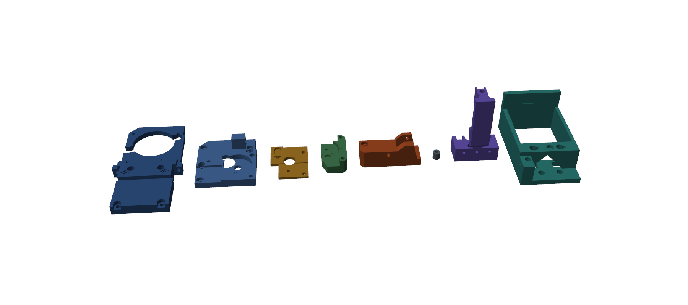
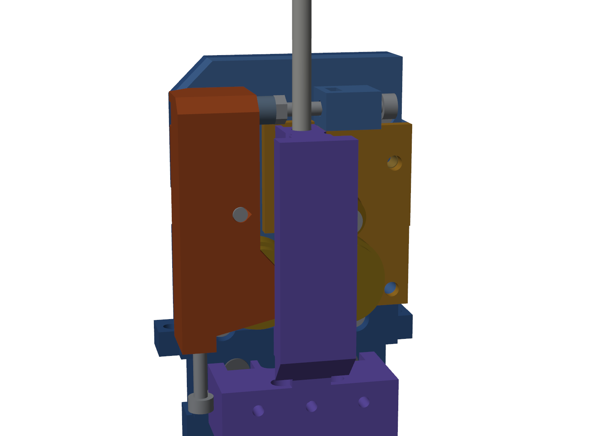
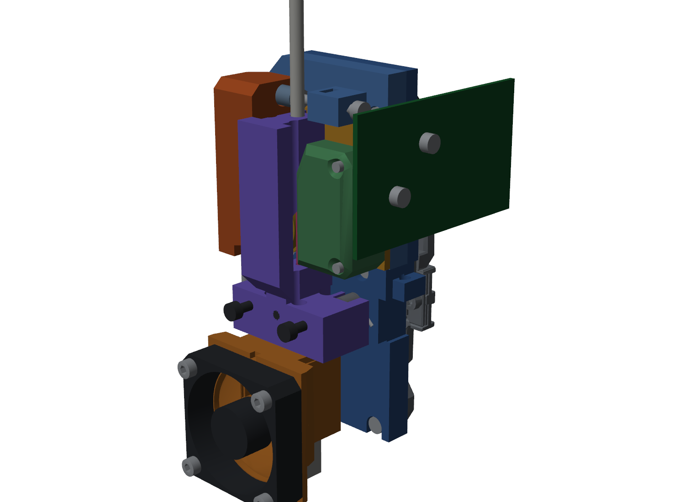
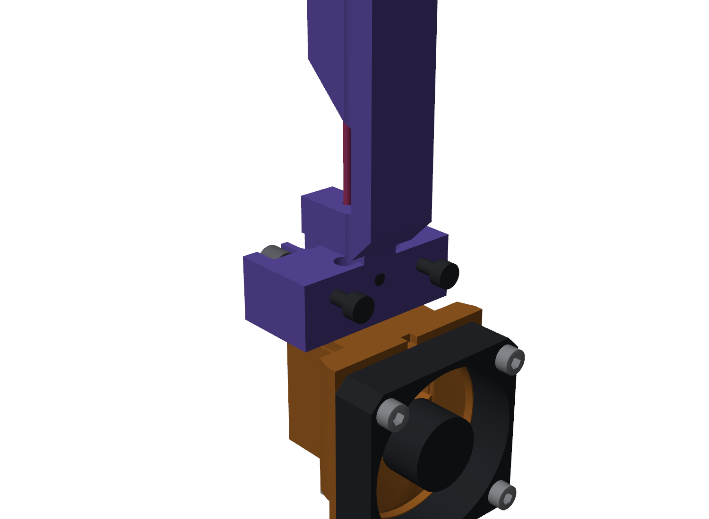
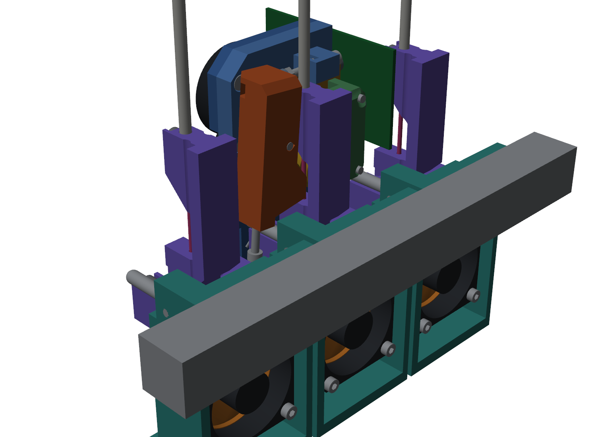

# Assembly guide (v36)

Draft guide for a draft design. It is written from the model; no part has been printed or assembled yet.
The pictures are renders of the model. For any step, the 3D viewer (`docs/index.html`) shows more: click a row in its parts list to highlight that part. Part numbers match `stl/` and `BOM.csv`.

Left and right are as you face the printer. The swing arm is on the left, the gear housing and the SB2209 on the right.

## 1 Print

Print the parts in `stl/` as they are oriented, without supports: ABS or ASA, 0.2 mm layers, 4 walls, 40 % infill or more.
Per tool you need one tool body, one shroud (v32 part 11 or 12) and one dock. The duct is the v32 part 09.

## 2 Prepare the printed parts

1. Front slab: press one M3 heat-set insert into the front, upper right (for the upper gear housing screw). Drop an M3 hex nut into the slot in the spring boss (upper right of centre).
2. Body: glue two 1.5 x 5 pins side by side into each of the two lower slots. Glue two stacked magnets into each lower pocket, the outer one 0.45 mm proud.
3. Coupling plate: glue two 1.5 x 5 pins into the top slot. Glue one magnet into each end of the top pocket, 0.45 mm proud.
4. Check polarity before the glue sets: every magnet on the head must attract its partner on the tool.
5. Tool body: press three ball-end pins into the back (one top, two bottom) until the shoulder is 0.5 mm proud. Glue two stacked magnets into each lower slot and two single magnets into the top slot, all flush with the back.
6. Tool body front: two M3x12 grade 12.9 screws, heads 5 mm proud. One steel M3x5 set screw in the centre hole, flush.
7. Dock: glue one magnet into the pocket in the tongue. Stick the silicone strip into the recess on the floor.

## 3 Build the head on the bench

1. Screw the slab onto the body with three M3x10 (two top corners, one lower left). They cut their own thread; do not overtighten.
2. Press the 3 x 24 pivot pin into the slab (upper left) and one 3 x 16 axle pin into the slab (lower right).
3. Press one MR63 bearing into the floor of the round pocket in the slab. Fit the dual gear, small gear to the front.
4. Motor: pass it through the body from behind so its boss sits in the slab. Two screws from the front: M3x8 upper right, M3x6 lower left. Check that the pinion turns the dual gear freely.
5. Fit the coupling plate over the dual gear and the axle pin.
6. Slide the fixed HGX gear onto its axle, hobbed end to the front.
7. Gear housing: press the second MR63 bearing into its back. Fit the housing over the gear, the dual gear's shaft and the axle pin. Fix with the M3x30 countersunk (lower) and the M3x20 countersunk (upper).
8. Swing arm: press the other 3 x 16 pin through the arm with the second HGX gear between the webs. Screw the M3x20 into the foot from below, leaving 12 mm of shank showing. Slide the arm onto the pivot pin.
9. Spring: thread the M3x35 through the boss and its nut from the right. Add the nyloc and the spring on the left end, with the screw's tip in the arm's slot. Start with the spring squeezed to about 8.5 mm.
10. SB2209: two M3x12 through the board and the two spacers into the right side of the gear housing and of the slab. The board stands upright, long edge front to back, as on a CW2.

## 4 Mount the head

1. Two M3x16 through the body into the top holes of the Tap, two M3x8 into the bottom holes.
2. Duct and fans as in v32: two M3x10 down through the body's ears into the inserts in the duct legs.

## 5 Tools

1. Shroud over the hotend, tool body on top, four M2.5x10 through both into the heatsink. The two front screws drop in from the top; the two rear ones go in through the slots in the back of the base.
2. PTFE tube into the top of the tool body. Feed filament down through the body until it shows below the upper guide.

## 6 Docks

1. One dock per tool on the back slot of the front rail, 54 mm apart, two M5x10 with T-nuts each. The docks must sit in front of the bed: the dock floor is 6 mm below the nozzle.
2. Push the 5 mm pin into the block on the left of each dock, rounded end to the back, 29 mm showing. Lock it with the M3x5 set screw.

## 7 Set up

1. Hang a tool on the head by hand. Jog to a dock so both hook screws pass through the large holes without touching. That is the dock position.
2. Jog 3 mm to the right. The hooks must slide into the slots and the swing arm must open; the gears must let go of the filament.
3. Macro sequence, release: 30 mm behind the dock, in, 3 mm right, out 30 mm, 3 mm left. Pickup: 3 mm right, in, 3 mm left, out. Never move sideways while less than 30 mm out with a tool parked.
4. Spring: tighten until the gears feed without slipping. More than needed makes the tool change harder.

## Not yet known

- Whether the Tap's bottom holes take an M3x8 (thread depth not measured).
- Whether your HGX kit matches the gear sizes taken from the CxChanger CAD.
- How well twelve 6 x 2.65 magnets hold a tool against nozzle drag.
