# Assembly guide (v30.6)

This guide builds the head, the tools and the docks from loose parts, including the stock Clockwork 2 drivetrain (bearings, gears, shafts, motor) and every screw. Part numbers match `stl/` and `BOM.csv`. The 3D viewer (`docs/index.html`) shows the finished assembly. For the tool-change sequence and audit notes, see [ASSEMBLY.md](ASSEMBLY.md).

The CW2 steps follow the official Voron Stealthburner manual; the page numbers are given so you can cross-check against it.

## Exploded views

### Head


| # | Part | # | Part |
|---|---|---|---|
| 1 | CNC Tap V2 (already on the printer) | 19 | LDO-36 motor (round NEMA14) |
| 2 | 05 Motor plate | 20 | 06 Servo bracket |
| 3 | MR85 bearing, plate side | 21 | FS90 servo, with its 2 M2 tab screws |
| 4 | Drive shaft + 50T gear (BMG kit) | 22 | M3×12 SHCS ×2: bracket → plate |
| 5 | Drive gear + M3 set screw (BMG kit) | 23 | 04 Servo crank |
| 6 | MR85 bearing, body side | 24 | 03 Trunnion |
| 7 | 01 CW2 main body | 25 | M2×3 button head + M2 washer |
| 8 | M3×6 FHCS: anti-squish stop, inside the body | 26 | Pull rod: M3×55 SHCS, 3× M3 nyloc, 2× M3 washer, stock CW2 spring |
| 9 | 02 Guidler A + mast | 27 | 08 Receiver frame |
| 10 | 02b Guidler B | 28 | 07 Receiver |
| 11 | BMG idler gear (with its bearings) | 29 | Ø3×30 dowel ×2 |
| 12 | Ø3×20 idler shaft | 30 | Ø6×2.65 magnet ×4 |
| 13 | M3×16 SHCS: Guidler A + B | 31 | M3×6 SHCS ×2: receiver → frame |
| 14 | M3×25 SHCS: guidler pivot | 32 | M3×20 SHCS ×2: frame → Tap |
| 15 | M3×25 SHCS ×2: body → plate | 33 | M3×10 SHCS ×2: frame posts → body |
| 16 | M3×30 SHCS: motor, top | 34 | 09 Duct + fan mount |
| 17 | M3×8 SHCS + M3 washer: motor, slotted hole | 35 | M3×10 SHCS ×2: duct → frame |
| 18 | M3×10 SHCS ×2: plate → Tap | | |

### Tool
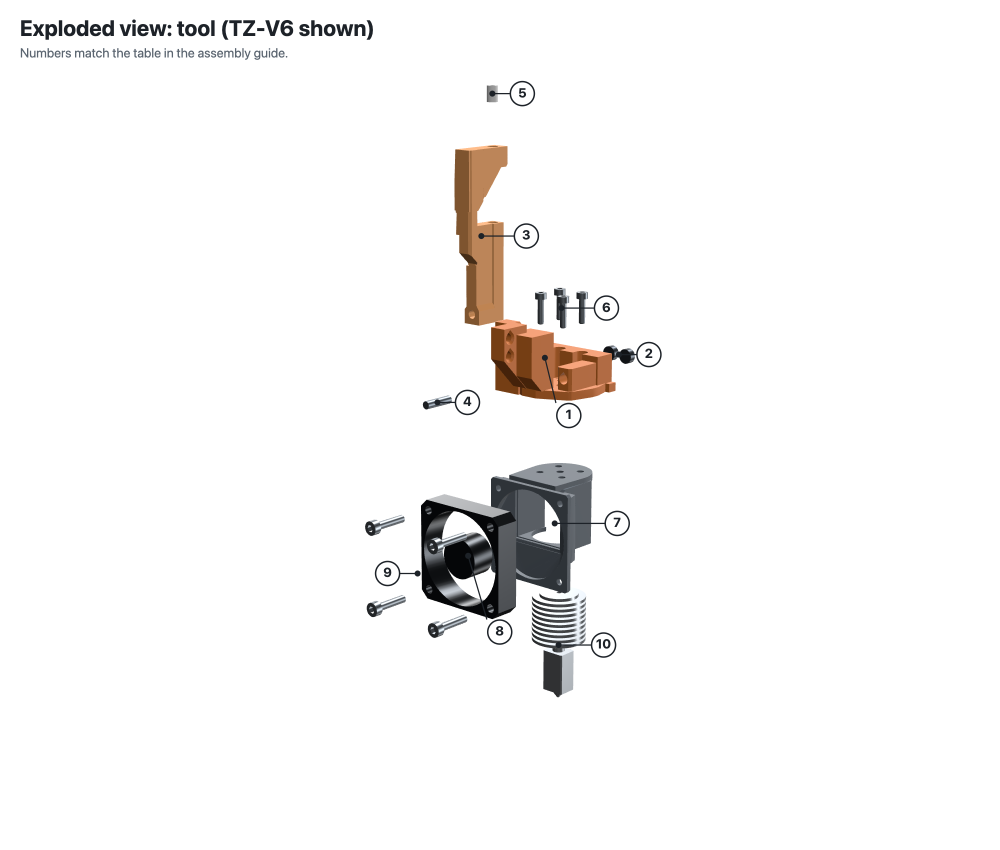

| # | Part | # | Part |
|---|---|---|---|
| 1 | 10 Tool top | 6 | M2.5×10 SHCS ×4: tool top → heatsink |
| 2 | Ø6×2.65 magnet ×2 | 7 | 11 Shroud 4010 (TZ-V6) or 12 (Dragon HF) |
| 3 | 10b Guide lever | 8 | 4010 fan, 24 V |
| 4 | Ø3×12 dowel: lever pivot | 9 | M3×14 SHCS ×4: fan → shroud |
| 5 | 4×2 PTFE tube | 10 | Hotend: Trianglelab TZ-V6 3.0 or Phaetus Dragon HF |

## Complete hardware list

### Head (1 per printer)

| Qty | Item | Where |
|---|---|---|
| 1 set | Bondtech BMG gear kit (or a good clone): drive shaft with 50T gear, drive gear with M3 set screw, idler gear with its bearings, Ø3×20 idler shaft | CW2 drivetrain |
| 2 | MR85 bearing (Ø8 × Ø5 × 2.5) | drive shaft: 1 in the plate, 1 in the body |
| 1 | LDO-36STH20 round NEMA14 motor with pinion | CW2 |
| 1 | BMG idler spring (from the BMG thumbscrew set) | pull rod; the thumbscrew itself is not used |
| 12 | M3×5×4 heat-set insert (Ø5 × 4 mm) | body 3, plate 7, duct 2 |
| 1 | M3×6 FHCS | anti-squish stop in the body |
| 1 | M3×16 SHCS | Guidler A + B |
| 3 | M3×25 SHCS | 2× body → plate, 1× guidler pivot |
| 1 | M3×30 SHCS | motor, top hole |
| 1 | M3×8 SHCS | motor, slotted hole |
| 3 | M3 washer | 1 under the M3×8 motor screw, 2 on the pull rod |
| 2 | M3×10 SHCS | motor plate → CNC Tap |
| 1 | FS90 (or MG90S) micro servo, with its 2 M2 tab screws | opener |
| 2 | M3×12 SHCS | servo bracket → plate |
| 1 | M2×3 button head + M2 washer | trunnion → crank |
| 1 | M3×55 SHCS | pull rod |
| 3 | M3 nyloc nut | pull rod: push, stop and tension nuts |
| 2 | Ø3×30 hardened dowel | receiver |
| 4 | Ø6×2.65 magnet | receiver |
| 2 | M3×6 SHCS | receiver → receiver frame |
| 2 | M3×20 SHCS | receiver frame → CNC Tap |
| 4 | M3×10 SHCS | 2× frame posts → body, 2× duct → frame |

### Per tool

| Qty | Item | Where |
|---|---|---|
| 1 | Trianglelab TZ-V6 3.0 or Phaetus Dragon HF | hotend |
| 1 | 4010 fan, 24 V | heatsink fan |
| 4 | M2.5×10 SHCS | tool top → heatsink |
| 4 | M3×14 SHCS | fan → shroud |
| 2 | Ø6×2.65 magnet | tool top |
| 1 | Ø3×12 hardened dowel | guide-lever pivot |
| 1 | 4×2 PTFE tube | lever → spool |
| 2 | zip tie, max 3.6 mm wide | hotend loom |

### Per dock

| Qty | Item |
|---|---|
| 2 | Ø3×15 hardened dowel |
| 2 | M5×10 SHCS |
| 2 | M5 drop-in T-nut for 2020 |

Plus one 2020 extrusion for the dock rail, tools × 63 mm + 40 mm long.

**Stock Stealthburner/CW2 parts you don't need:** the BMG thumbscrew (keep its spring), the CW2 latch and its M3×25, and the Stealthburner cable bridge and cover with their screws.

**Tools:** soldering iron with an M3 insert tip, 1.5, 2 and 2.5 mm hex keys (the 2.5 mm one at least 70 mm long, to reach the plate screws through the body), 5.5 mm nut driver, small vice or arbor press for the dowels and bearings, medium-strength thread locker, light grease for the idler gear.

**Printing:** all printed parts from `stl/` in ASA, PETG or PC-CF; 0.2 mm layers, 4 walls, 40 % infill, no supports. Print the crank, trunnion, receiver and tool top in PC-CF if you can.

---

## 1. Prepare the printed parts

**Heat-set inserts.** Every insert in this build is an **M3×5×4** (Ø5 outer diameter, 4 mm long; the Voron standard). Every insert hole is **Ø4.7**. There are 12: 3 in the CW2 body, 7 in the motor plate and 2 in the duct. Press each one in straight and flush with the surface. Don't push them deeper.

### 1.1 CW2 main body: 3 inserts
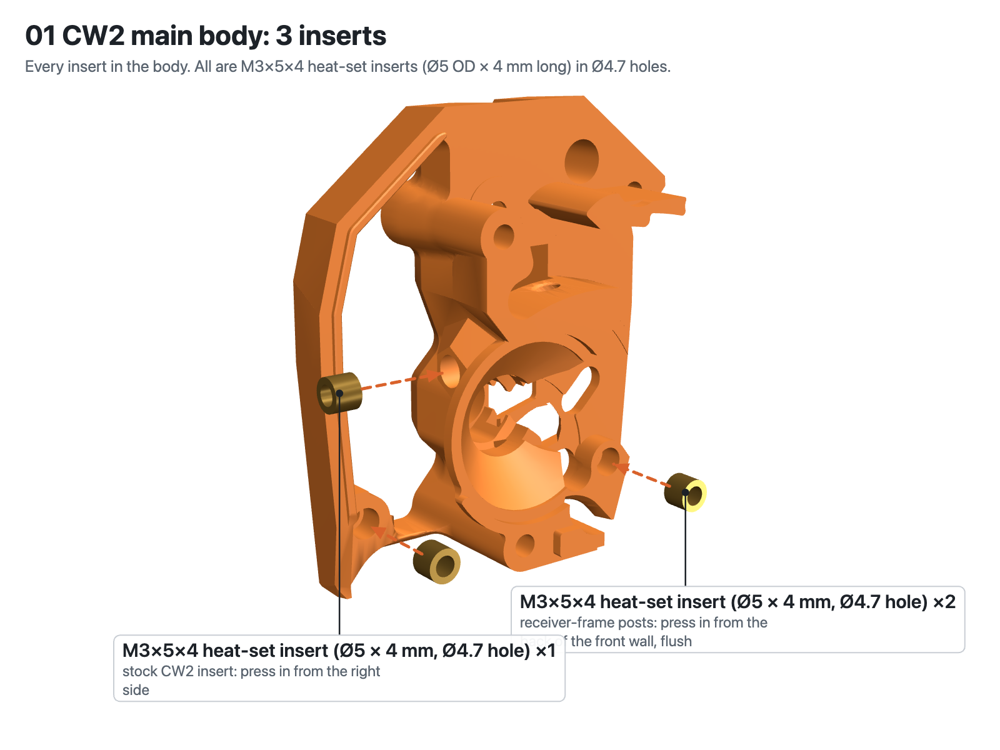

- 2 inserts for the receiver-frame posts. Press them in from the back of the front wall. The screws come in from the front, through the new Ø3.4 holes.
- 1 insert in the right side, as for a stock CW2.

### 1.2 Motor plate: 7 inserts
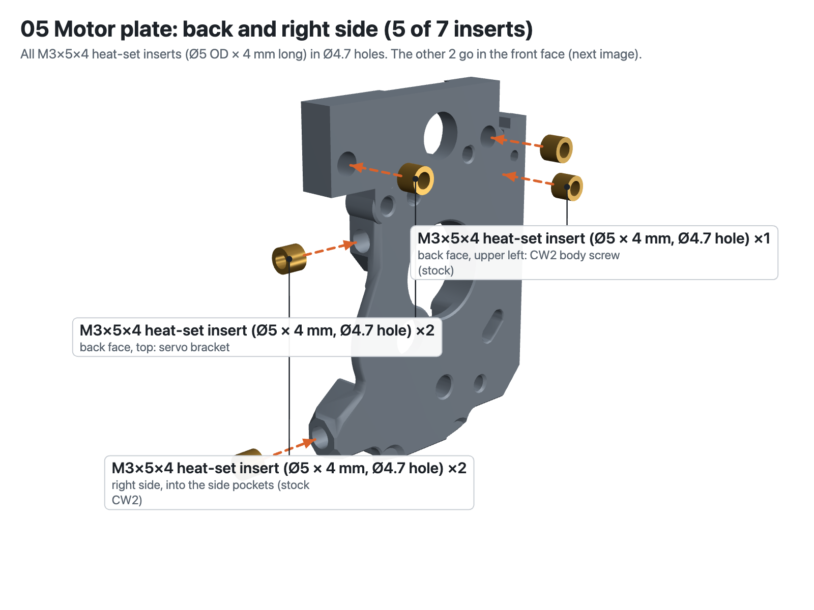
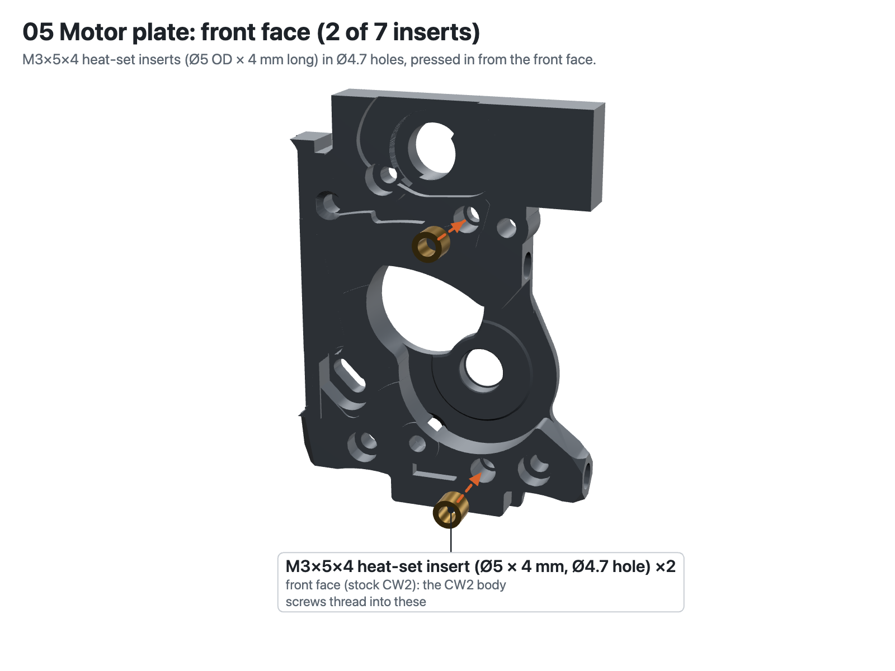

- **Back face, 3 inserts:** 2 at the top for the servo bracket, and 1 upper left for the CW2 body screw.
- **Right side, 2 inserts:** they go into the side pockets, as on a stock CW2 plate. In a Stealthburner they hold the cover; nothing in this build bolts to them, so they are optional.
- **Front face, 2 inserts:** the CW2 body screws thread into these.

### 1.3 Duct: 2 inserts
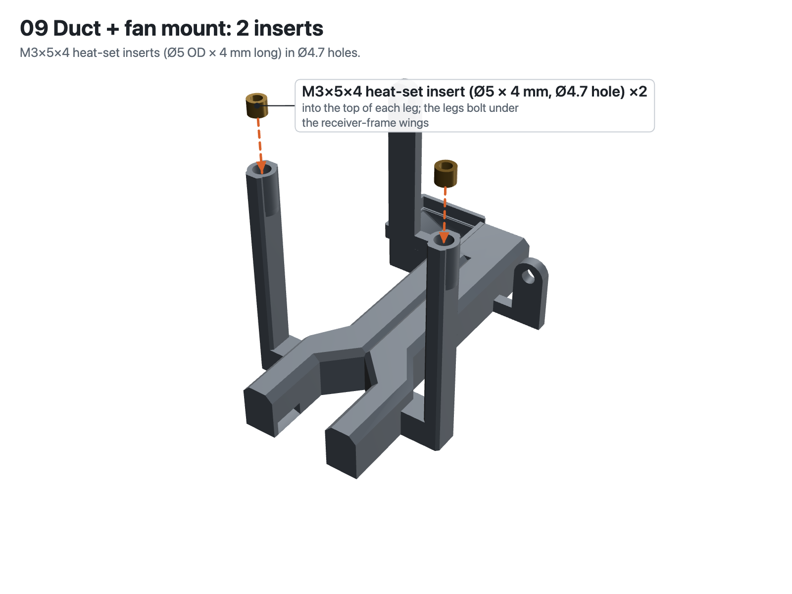

### 1.4 Receiver: dowels and magnets
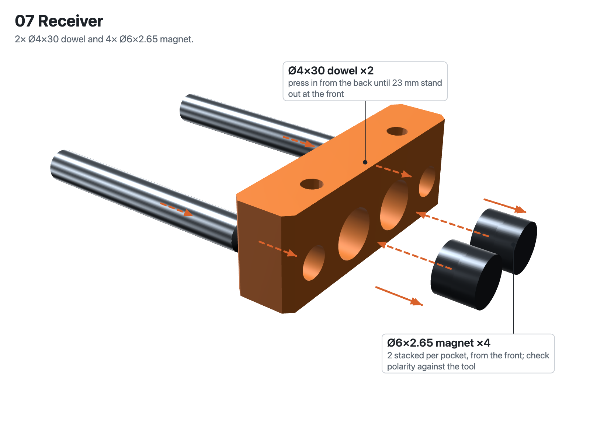

- **Dowels:** press 2 Ø3×30 dowels in from the back until **23 mm** stand out at the front.
- **Magnets:** fit 4 Ø6×2.65 magnets from the front, 2 stacked in each pocket. Mark their polarity: the tool magnets must attract them.

### 1.5 Tool top, for each tool
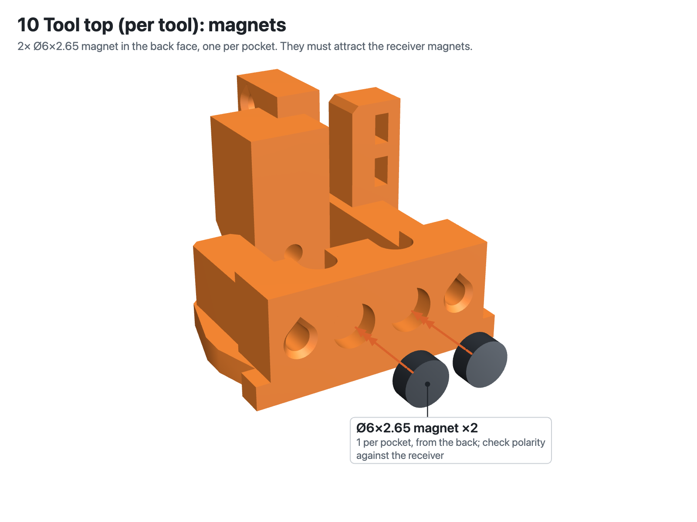
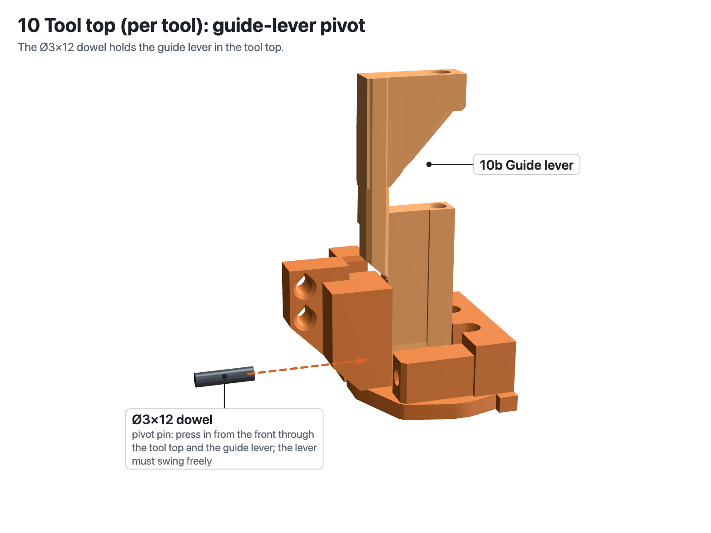

- **Magnets:** fit 2 Ø6×2.65 magnets from the back, 1 per pocket. Check that they *attract* the receiver magnets before you glue them.
- **Guide lever:** put the guide lever (10b) in place and press the Ø3×12 pivot pin in from the front. The lever must swing freely.

### 1.6 Dock, for each tool
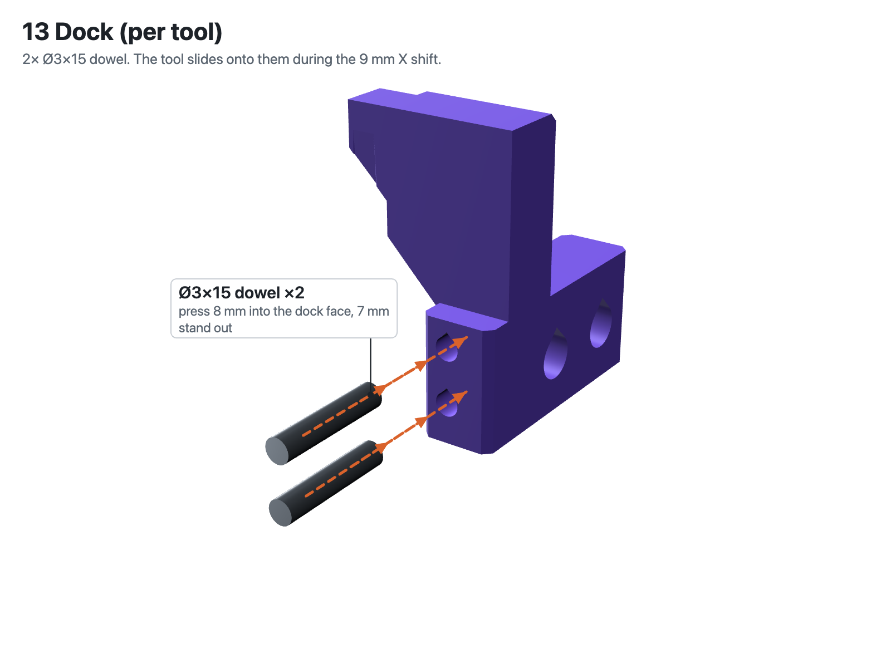

Press 2 Ø3×15 dowels **8 mm** into the dock face, so that **7 mm** stand out.

---

## 2. Electronics: servo on a BTT SB2209

Do this first. The crank goes onto the servo at its closed angle (section 3.9), so you need to be able to move the servo while the head is still on the bench. With the head next to the printer, plug the servo into the SB2209, using an extension lead if it doesn't reach. A hobby servo tester also works.

### 2.1 Wiring
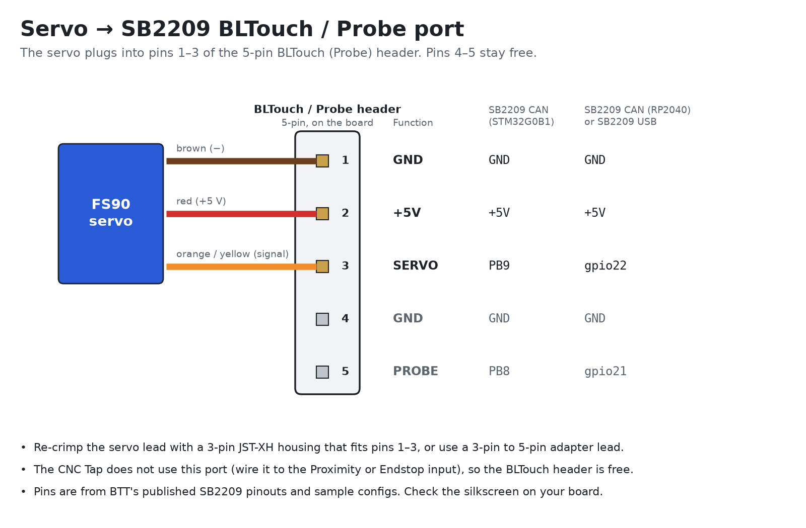

The servo plugs into **pins 1–3 of the 5-pin BLTouch (Probe) header**:

| Header pin | Signal | Servo wire | SB2209 CAN (STM32G0B1) | SB2209 CAN (RP2040) / SB2209 USB |
|---|---|---|---|---|
| 1 | GND | brown | GND | GND |
| 2 | +5V | red | +5V | +5V |
| 3 | servo signal | orange / yellow | `PB9` | `gpio22` |
| 4 | GND | not used | | |
| 5 | probe input | not used | `PB8` | `gpio21` |

- Re-crimp the servo lead with a 3-pin JST-XH housing that fits pins 1–3, or make a short 3-pin to 5-pin adapter lead.
- The CNC Tap does not use this header, so it is free. Wire the Tap to the Proximity or Endstop input, as in the Tap documentation.
- The pins above are from BTT's published SB2209 pinouts and sample configs. Check them against the silkscreen on your board.

### 2.2 Klipper config
Add this to `printer.cfg`, or to the file that holds your SB2209 config. Use the MCU name from your own `[mcu ...]` section; `EBBCan` is the name in BTT's sample config.

```ini
[servo opener]
pin: EBBCan:PB9                 # SB2209 CAN (STM32G0B1)
#pin: EBBCan:gpio22             # SB2209 CAN (RP2040) or SB2209 USB
maximum_servo_angle: 180
minimum_pulse_width: 0.0005
maximum_pulse_width: 0.0025
# no initial_angle: the servo stays off at start-up, and the over-centre crank holds the idler closed

[gcode_macro OPENER_CLOSE]
description: Close the idler (crank goes over centre), then switch the servo off
variable_angle: 8               # set this on your printer, see 6.1
gcode:
    SET_SERVO SERVO=opener ANGLE={printer["gcode_macro OPENER_CLOSE"].angle}
    G4 P500
    SET_SERVO SERVO=opener WIDTH=0

[gcode_macro OPENER_OPEN]
description: Open the idler, then switch the servo off
variable_angle: 174             # closed angle + 166 (or closed − 166 if your servo turns the other way)
gcode:
    SET_SERVO SERVO=opener ANGLE={printer["gcode_macro OPENER_OPEN"].angle}
    G4 P500
    SET_SERVO SERVO=opener WIDTH=0
```

- Don't define `[bltouch]` on the same pins.
- The servo signal is switched off after every move (`WIDTH=0`). With the crank over centre, the spring holds the idler closed. When open, nothing loads the crank, so the servo doesn't buzz between tool changes.

---

## 3. Build the head on the bench

The whole head is built off the printer: the CW2 with its motor, then the servo, the crank and the pull rod. It then goes onto the Tap in one piece (section 4).

The two screws that hold the motor plate to the Tap must go into the plate **before** the main body (CW2 step 5). Their heads can't pass through the body afterwards, but a 2.5 mm hex key can, so you tighten them through the body once the head is on the Tap.

### 3.1 CW2 step 1: bearing into the motor plate
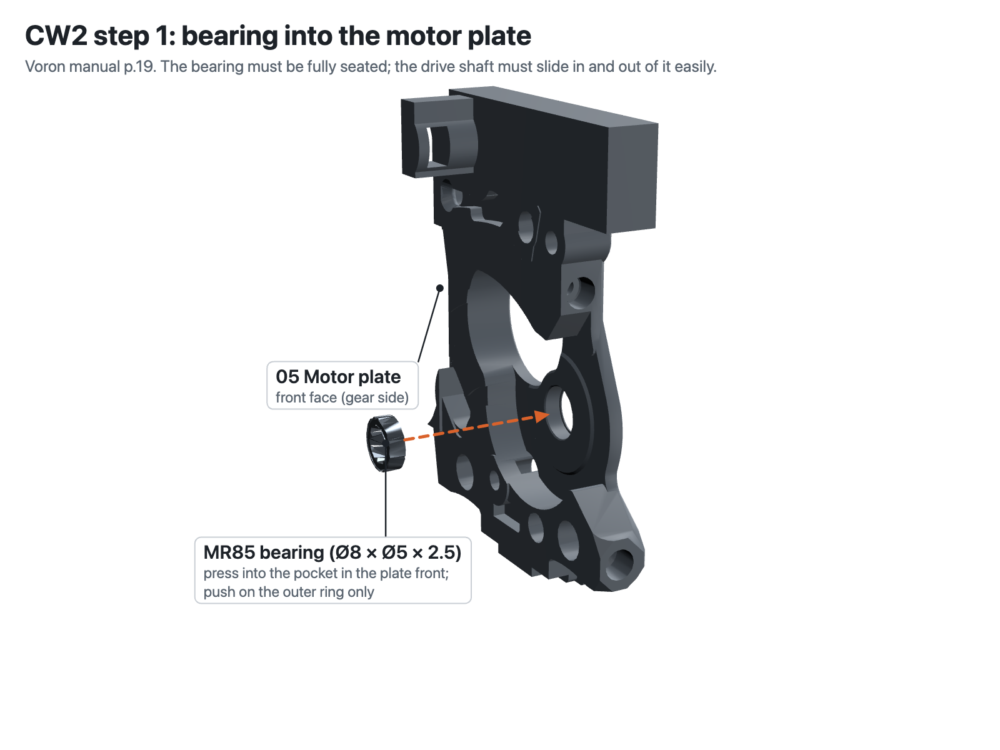

Press one **MR85** into the pocket on the plate's front face. Push on the outer ring only, until it is fully seated. The drive shaft must slide in and out of it easily; if not, sand the shaft lightly, don't force it.

### 3.2 CW2 step 2: bearing and anti-squish screw into the main body
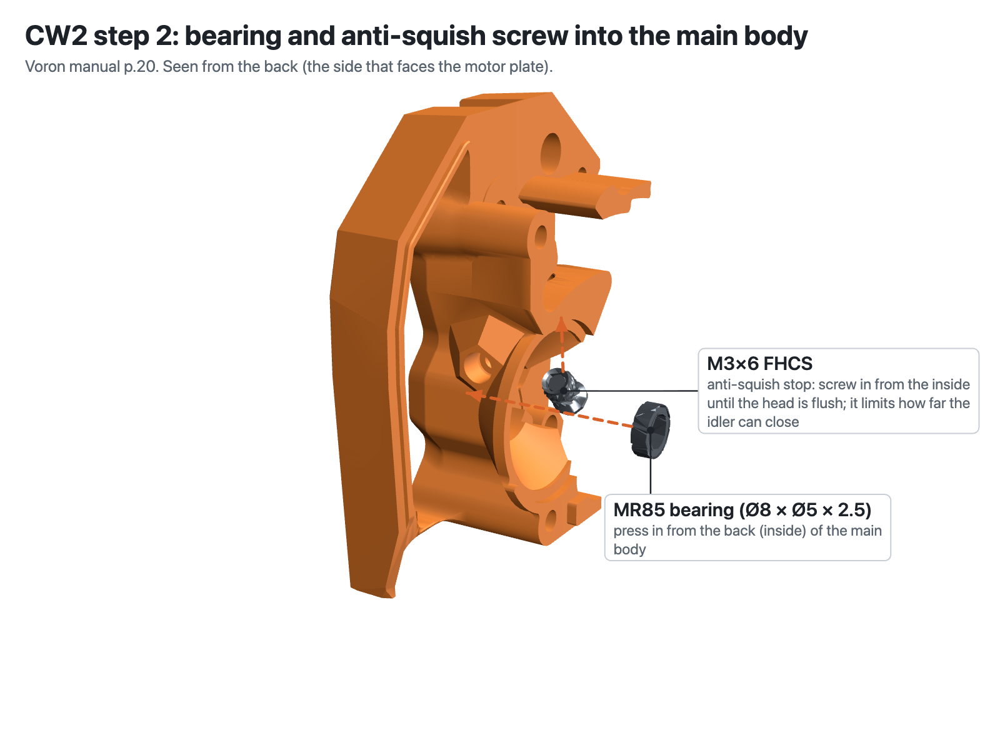

1. Press the second **MR85** into the body from the back (the inside).
2. Screw the **M3×6 FHCS** in from the inside. It is the anti-squish stop: it sets how far the idler can close (Voron manual p.27).

### 3.3 CW2 step 3: drive shaft and drive gear
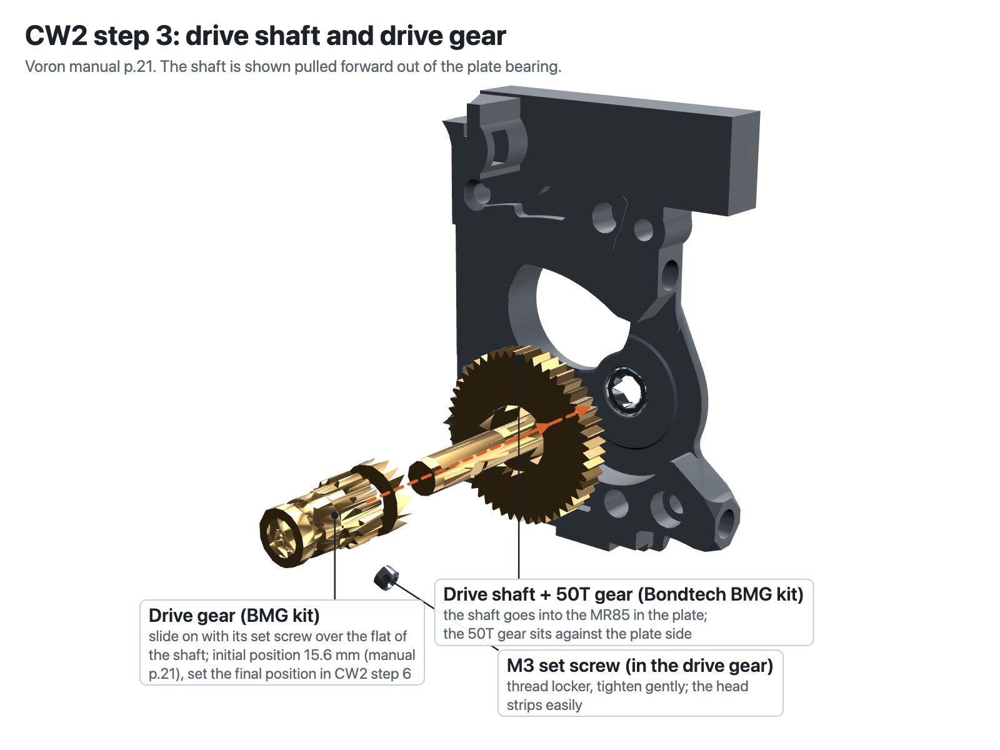

1. Slide the **drive gear** onto the drive shaft, with its **M3 set screw** over the flat on the shaft. Set it to the initial position from the Voron manual (p.21, 15.6 mm) and only nip the set screw for now.
2. Put the shaft's back end into the plate bearing. The **50T gear** sits on the plate side.

### 3.4 CW2 step 4: guidler and idler
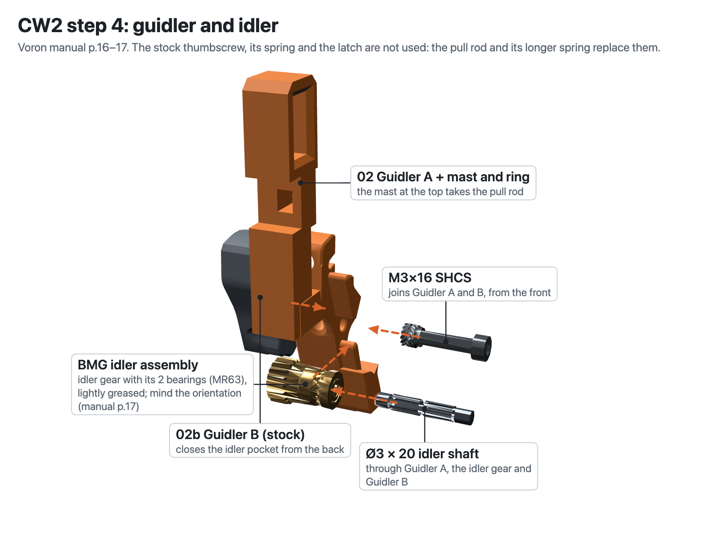

1. Grease the idler gear's bearings lightly.
2. Put the **idler gear** into Guidler A, mind the orientation (manual p.17), and push the **Ø3×20 idler shaft** through.
3. Close it with **02b Guidler B** and join the two halves with the **M3×16 SHCS** from the front.

The stock BMG thumbscrew and the CW2 latch are not fitted. Keep the thumbscrew's spring for the pull rod (section 3.10).

### 3.5 CW2 step 5: plate-to-Tap screws into the plate
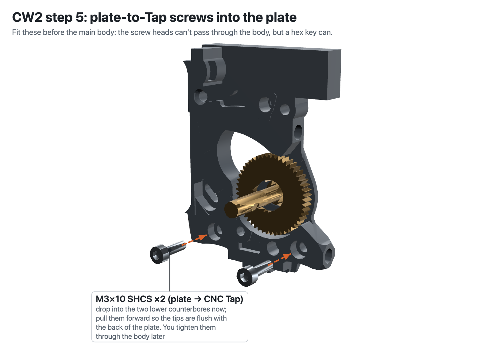

1. Drop **2× M3×10 SHCS** into the two lower counterbored holes in the plate's front face.
2. Pull them forward until their tips are flush with the back of the plate. The plate holes keep them straight, and the main body traps them in step 6.

### 3.6 CW2 step 6: main body and guidler
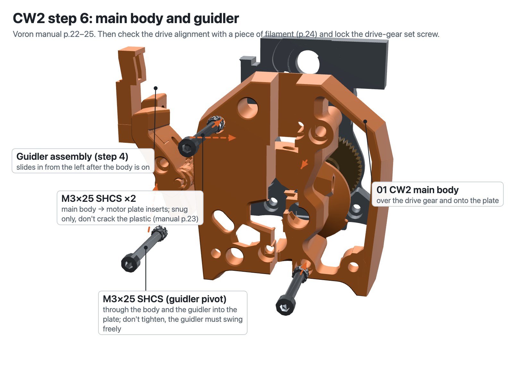

1. Fit the main body over the drive gear and onto the plate. The front end of the drive shaft goes into the body bearing.
2. Screw in **2× M3×25 SHCS** from the front into the plate inserts. Snug them only; overtightening cracks the body (manual p.23).
3. Slide the guidler assembly in from the left and fit the **M3×25 SHCS** pivot through the body and the guidler into the plate. **Don't tighten it**: the guidler must swing freely (manual p.25).
4. Check that the two plate-to-Tap screws from step 5 are still in their holes; you can see them through the round holes low in the body front.
5. **Drive alignment** (manual p.24): push a piece of 1.75 mm filament through. The filament must sit centred on the drive gear's teeth. Adjust the drive gear along the shaft if needed, then put thread locker on the set screw and tighten it gently; the hex strips easily.

### 3.7 CW2 step 7: motor
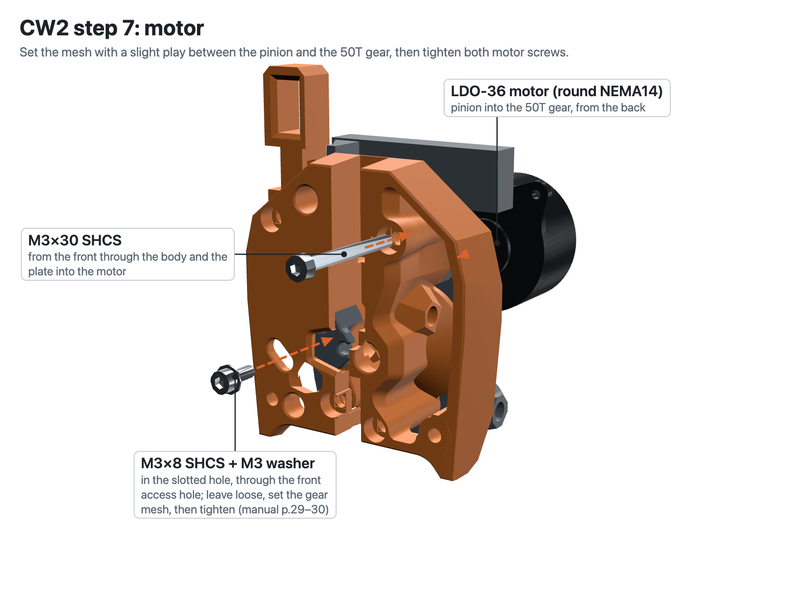

1. Offer the LDO-36 up from the back with its pinion in the 50T gear.
2. Fit the **M3×30 SHCS** from the front, through the body and the plate, into the motor's top hole.
3. Fit the **M3×8 SHCS + M3 washer** into the slotted hole, through the access hole in the front. Leave both loose.
4. Swing the motor so the pinion fully meshes with the 50T gear, with a slight play (not tight; manual p.30). Tighten both motor screws.

### 3.8 Servo and bracket
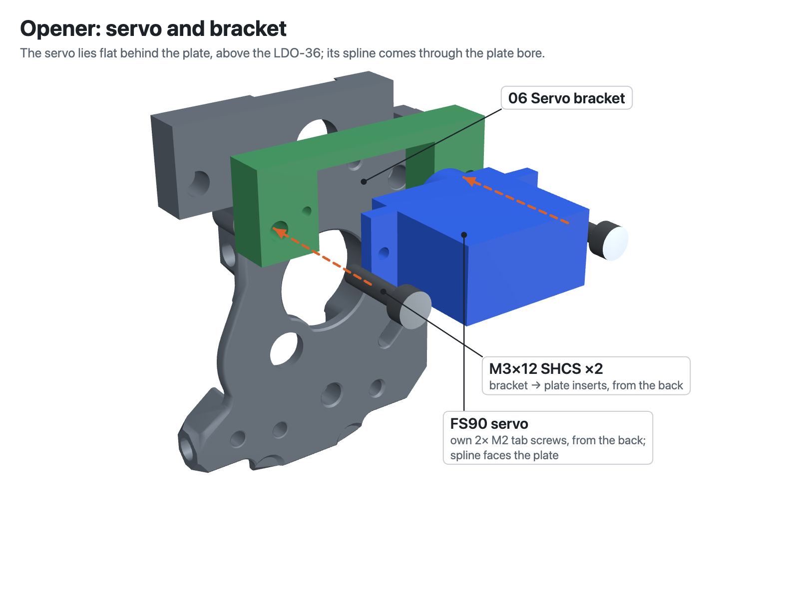

1. Fit the FS90 into the 06 bracket with its own 2 M2 tab screws, from the back. The spline faces the plate.
2. Bolt the bracket to the plate back with 2× **M3×12** into the two top inserts. The spline now sits inside the plate bore.

### 3.9 Crank and trunnion
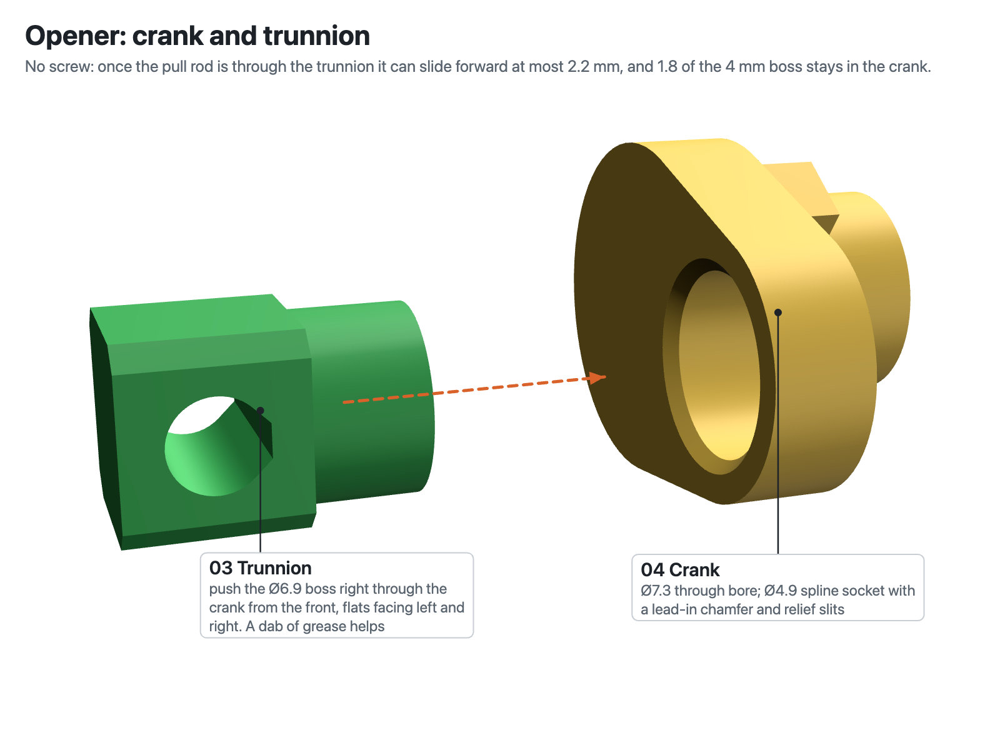

1. Push the 03 trunnion's round end and Ø4 spigot into the 04 crank from the front.
2. From the back of the crank, fit an **M2 washer** and an **M2×3 button head** into the spigot and tighten it. It clamps the spigot end, not the crank, so the trunnion still turns freely. Don't use an M2×4: it would reach the rod hole.
3. Power the servo (section 2) and send it to the closed angle: `SET_SERVO SERVO=opener ANGLE=8`.
4. From the front, put the crank's hub into the plate bore with its stop tab in the pocket and resting on the pocket's closed end. The trunnion points right, 6° below horizontal.
5. Push the crank onto the spline by hand. The socket is Ø4.75 with three relief slits; if it is too tight, open it with a 4.8 mm drill by hand.
6. Turn the trunnion so its flats face left and right.

### 3.10 Pull rod and tension
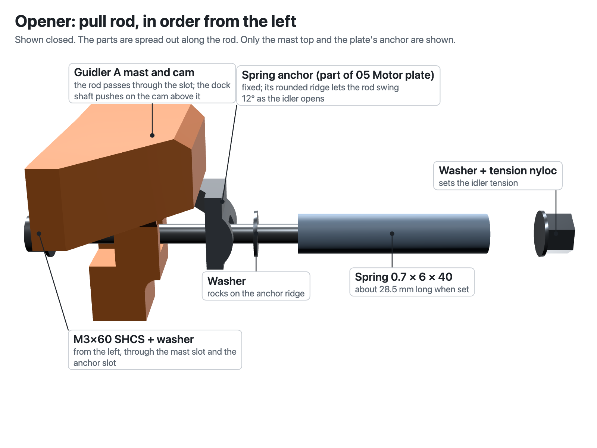

Thread the parts onto the M3×55 SHCS in this order, starting from the left:

1. Screw head and a washer, on the left of the Guidler A mast. Push the rod through the mast slot.
2. **Push nyloc:** run it up to the mast's right face, then back it off to about **0.2 mm** of play.
3. **Stop nyloc.**
4. The trunnion's cross hole.
5. The BMG idler spring.
6. A washer and the **tension nyloc**.

Then:

- **Stop gap:** with the crank closed, set a **2.5 mm** gap between the stop nyloc and the trunnion's left flat. This is how far the spring unloads before the idler starts to open.
- **Tension:** turn the tension nyloc; tighter means more grip. A good starting point is about **10.8 mm** of spring between the trunnion and the washer.
- **Bench check:** step the servo to the open angle and back (section 6.1, steps 2–3). The idler must open about 11° and close again, and the crank must come to rest on its stop.

The head is now complete.

---

## 4. Mount the head on the printer

### Mount step 1: head onto the CNC Tap
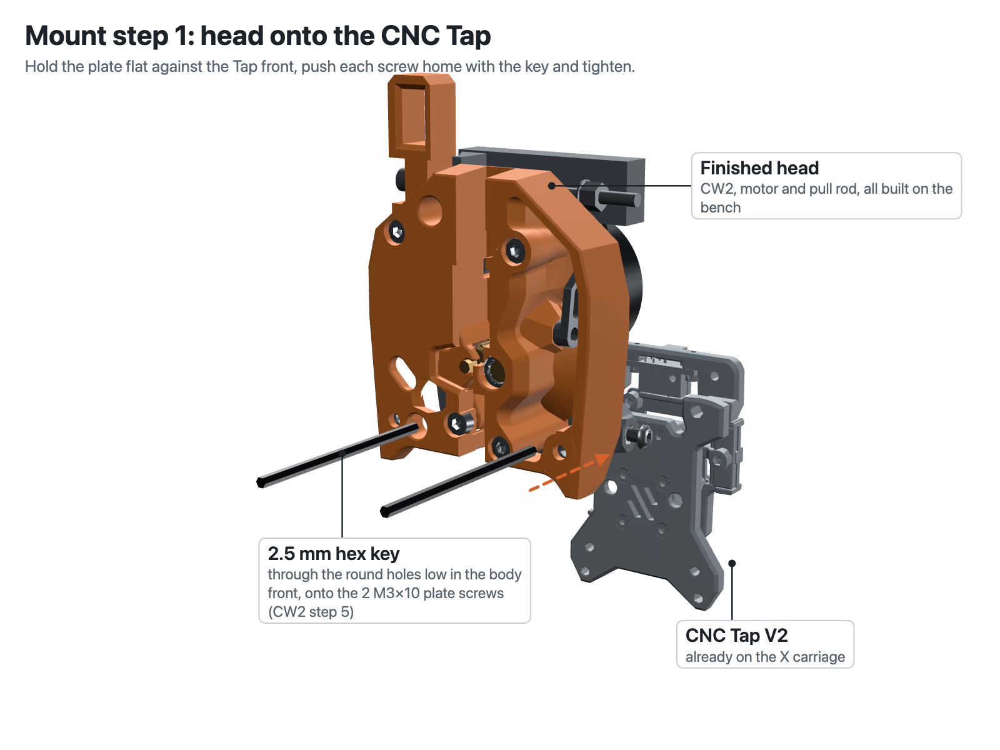

1. Offer the head up to the Tap from the front. The motor and the servo pass over the top of the Tap; the back of the plate sits flat against the Tap's front face.
2. Put a **2.5 mm hex key** (the long arm of a standard L key reaches) through the round hole low in the body front on each side, into the plate screws from CW2 step 5.
3. Push each screw home into its Tap hole and tighten it, while you hold the plate flat against the Tap.
4. Plug in the motor, and the servo if it isn't connected yet.

### Mount step 2: receiver into the receiver frame
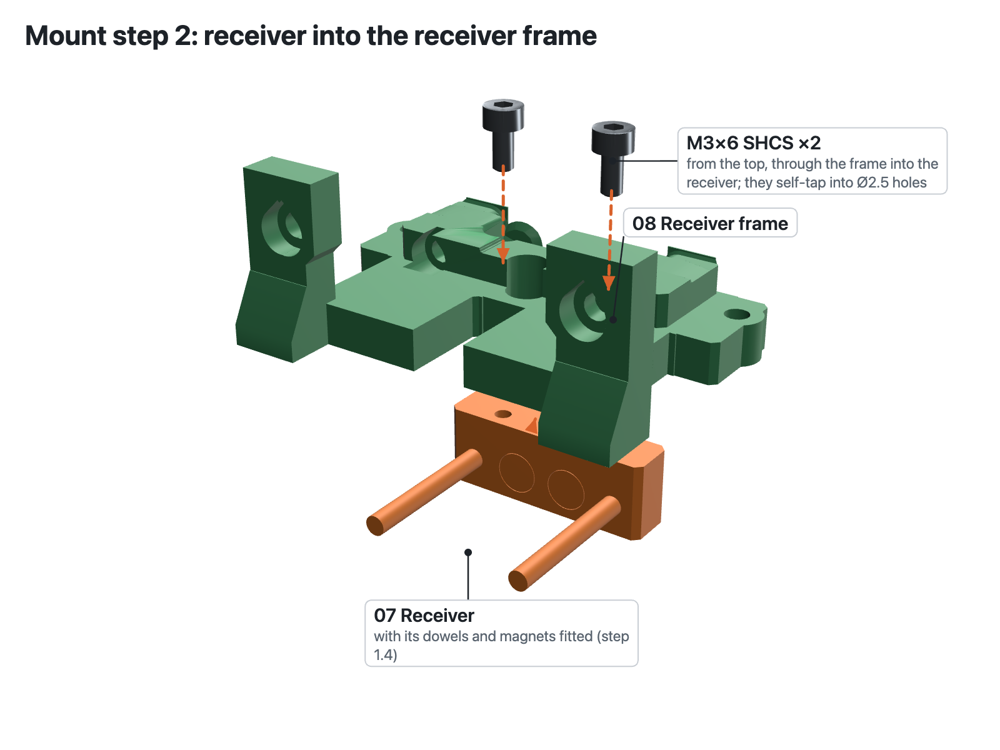

You can do this on the bench at any time. Screw the receiver (dowels and magnets already fitted) to the receiver frame with **2× M3×6 SHCS** from the top. They self-tap into Ø2.5 holes.

### Mount step 3: receiver frame onto the Tap and the CW2
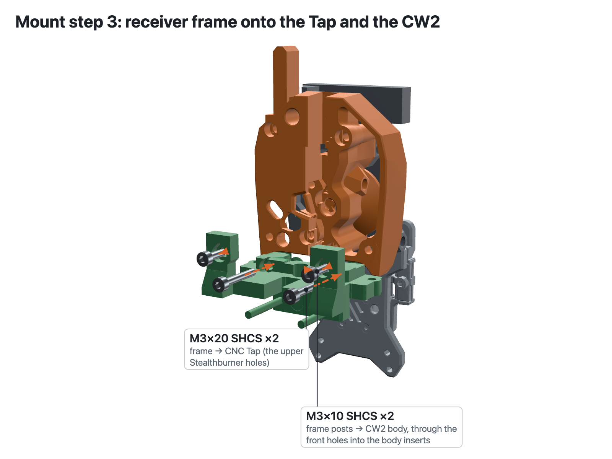

1. Bolt the frame to the CNC Tap with **2× M3×20 SHCS**, into the upper Stealthburner holes.
2. Bolt the frame posts to the CW2 front with **2× M3×10 SHCS**. They go through the body's front holes into the inserts from section 1.1.

### Mount step 4: duct
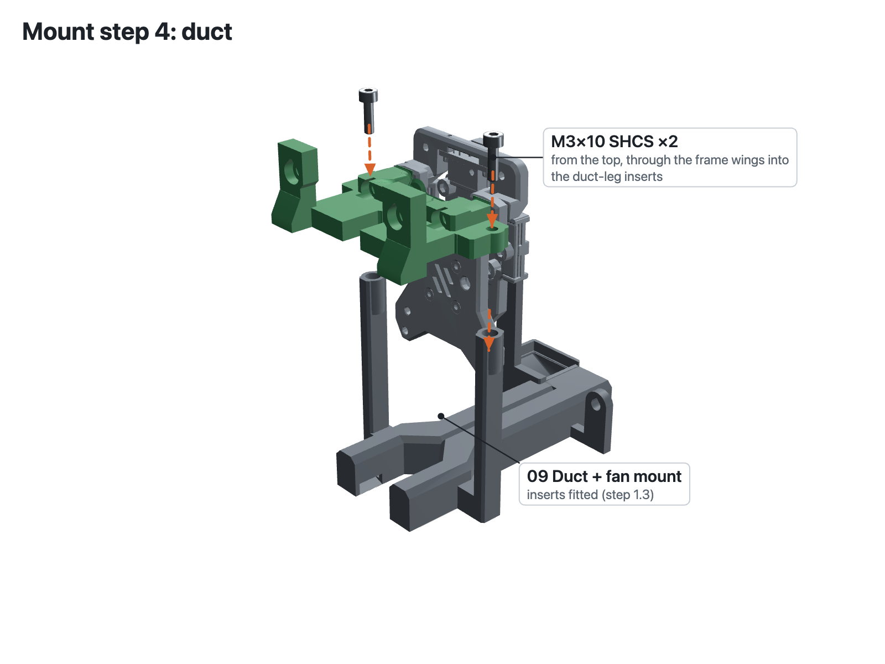

Bolt the duct legs under the frame wings with **2× M3×10 SHCS** from the top, into the duct inserts.

---

## 5. Tools and docks

### Tool
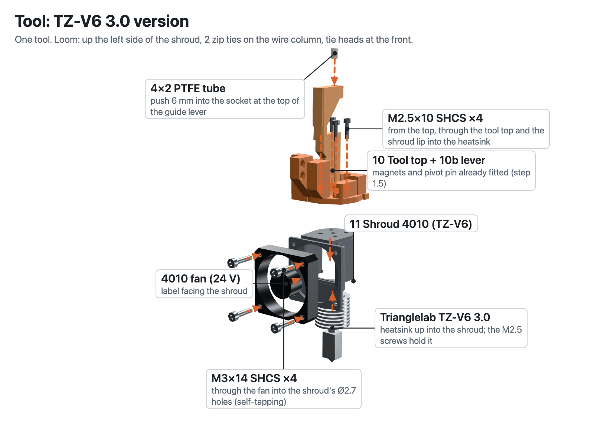
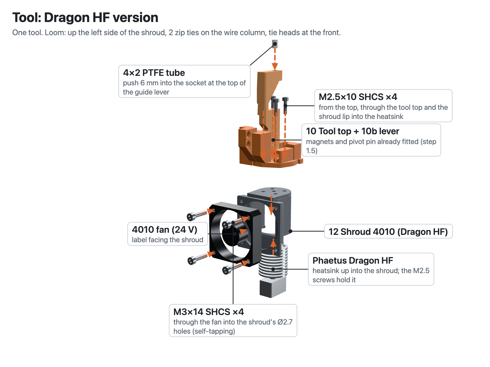

1. **Hotend:** put the 4010 shroud (11 for TZ-V6, 12 for Dragon HF) under the tool top and the heatsink up into the shroud. Fit **4× M2.5×10 SHCS** from the top, through the tool top and the shroud lip, into the heatsink.
2. **Fan:** fix the 4010 fan with **4× M3×14 SHCS**; they self-tap into the shroud's 4 Ø2.7 holes.
3. **PTFE:** push the 4×2 PTFE 6 mm into the socket at the top of the guide lever.
4. **Wires:** run the hotend loom up the left side of the shroud. Hold it to the wire column with 2 zip ties, with the tie heads on the front or outer face, never at the back.

### Docks
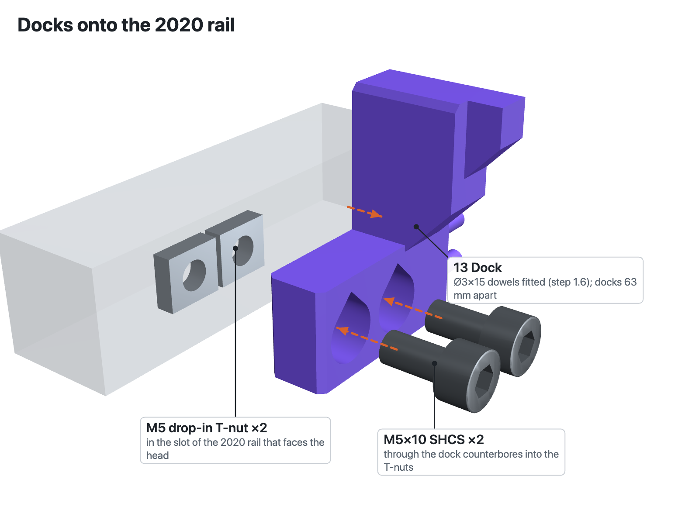

Bolt each dock to the 2020 rail with **2× M5×10 SHCS** into drop-in T-nuts, in the slot that faces the head. Space the docks 63 mm apart.

---

## 6. Set up and test

### 6.1 Setting the angles
1. **Closed angle:** the crank went on at `ANGLE=8` (section 3.9).
2. Step it slowly: `SET_SERVO SERVO=opener ANGLE=30`, then 60, 90 and so on. The crank should swing **up and to the left**, over the top. If it moves down first, your servo turns the other way. In that case, refit the crank at `ANGLE=172` and step it down towards 6.
3. **Open angle:** closed + 166° (or closed − 166°). Use it when the trunnion has swung over the top to the left and Guidler A is fully open (about 11°).
4. **Fine-tune the closed angle:** the angle where the crank tab just rests on its stop in the plate and the servo doesn't buzz. One spline tooth is about 17°. If the end positions are a tooth off, refit the crank one tooth over rather than forcing the angle.
5. Put the two angles into the `variable_angle` lines of `OPENER_CLOSE` and `OPENER_OPEN`.
6. **Check the tension:** with filament loaded and the idler closed, a push on the extruder by hand should feed it without the gears slipping. Adjust with the tension nyloc (section 3.10).

### 6.2 In the tool-change macros
Call `OPENER_OPEN` before the X shift into the dock, and `OPENER_CLOSE` after the X shift out with the new tool. The full drop and pickup sequence is in [ASSEMBLY.md](ASSEMBLY.md#klipper).
