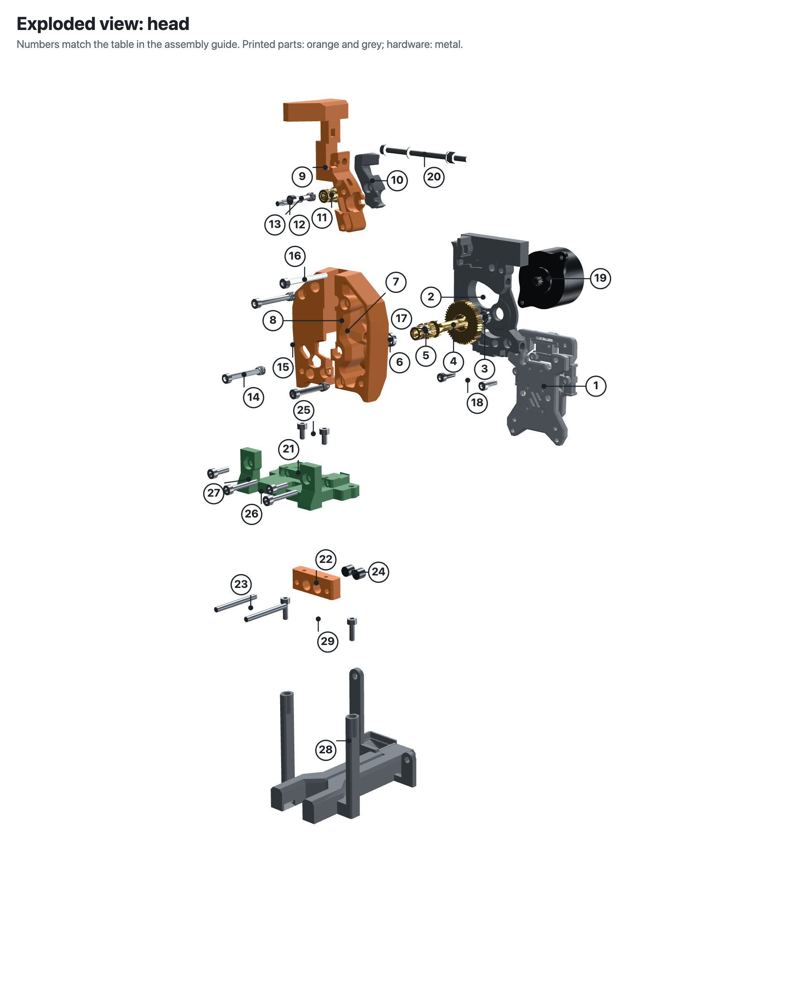
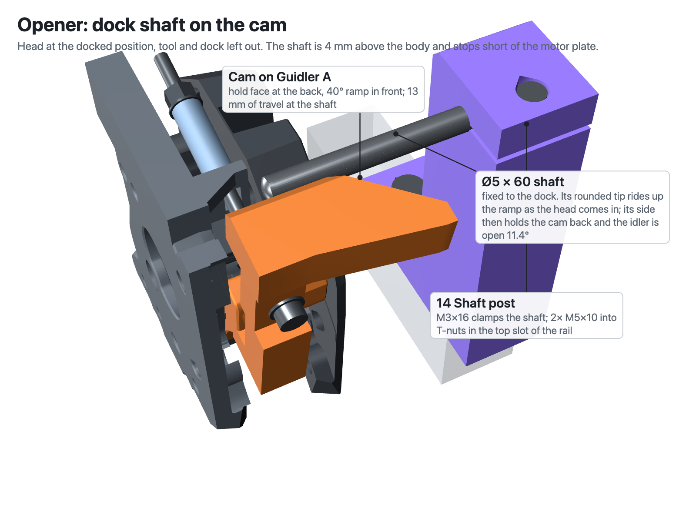

# Assembly guide (v32.2)

This guide builds the head, the tools and the docks from loose parts, including the stock Clockwork 2 drivetrain (bearings, gears, shafts, motor) and every screw. Part numbers match `stl/` and `BOM.csv`. The 3D viewer (`docs/index.html`) shows the finished assembly. For the tool-change sequence and audit notes, see [ASSEMBLY.md](ASSEMBLY.md).

The CW2 steps follow the official Voron Stealthburner manual; the page numbers are given so you can cross-check against it.

## Exploded views

### Head

| # | Part | # | Part |
|---|---|---|---|
| 1 | CNC Tap V2 (already on the printer) | 16 | M3×30 SHCS: motor, top |
| 2 | 05 Motor plate | 17 | M3×8 SHCS + M3 washer: motor, slotted hole |
| 3 | MR85 bearing, plate side | 18 | M3×10 SHCS ×2: plate → Tap |
| 4 | Drive shaft + 50T gear (BMG kit) | 19 | LDO-36 motor (round NEMA14) |
| 5 | Drive gear + M3 set screw (BMG kit) | 20 | Pull rod: M3×60 SHCS, M3 nyloc, 3× M3 washer, spring 0.7 × 6 × 40 |
| 6 | MR85 bearing, body side | 21 | 08 Receiver frame |
| 7 | 01 CW2 main body | 22 | 07 Receiver |
| 8 | M3×6 FHCS: anti-squish stop, inside the body | 23 | Ø3×30 dowel ×2 |
| 9 | 02 Guidler A + mast and cam | 24 | Ø6×2.65 magnet ×4 |
| 10 | 02b Guidler B | 25 | M3×6 SHCS ×2: receiver → frame |
| 11 | BMG idler gear (with its bearings) | 26 | M3×20 SHCS ×2: frame → Tap |
| 12 | Ø3×20 idler shaft | 27 | M3×10 SHCS ×2: frame posts → body |
| 13 | M3×16 SHCS: Guidler A + B | 28 | 09 Duct + fan mount |
| 14 | M3×25 SHCS: guidler pivot | 29 | M3×10 SHCS ×2: duct → frame |
| 15 | M3×25 SHCS ×2: body → plate | | |

### Tool

| # | Part | # | Part |
|---|---|---|---|
| 1 | 10 Tool top | 6 | M2.5×10 SHCS ×4: tool top → heatsink |
| 2 | Ø6×2.65 magnet ×2 | 7 | 11 Shroud 4010 (TZ-V6) or 12 (Dragon HF) |
| 3 | 10b Guide lever | 8 | 4010 fan, 24 V |
| 4 | Ø3×12 dowel: lever pivot | 9 | M3×14 SHCS ×4: fan → shroud |
| 5 | 4×2 PTFE tube | 10 | Hotend: Trianglelab TZ-V6 3.0 or Phaetus Dragon HF |

## Complete hardware list

### Head (1 per printer)

| Qty | Item | Where |
|---|---|---|
| 1 set | Bondtech BMG gear kit (or a good clone): drive shaft with 50T gear, drive gear with M3 set screw, idler gear with its bearings, Ø3×20 idler shaft | CW2 drivetrain |
| 2 | MR85 bearing (Ø8 × Ø5 × 2.5) | drive shaft: 1 in the plate, 1 in the body |
| 1 | LDO-36STH20 round NEMA14 motor with pinion | CW2 |
| 1 | Compression spring, 0.7 mm wire × 6 mm OD × 40 mm long, about 1.2 N/mm (1.0 to 1.4 works) | pull rod |
| 10 | M3×5×4 heat-set insert (Ø5 × 4 mm) | body 3, plate 5, duct 2 |
| 1 | M3×6 FHCS | anti-squish stop in the body |
| 1 | M3×16 SHCS | Guidler A + B |
| 3 | M3×25 SHCS | 2× body → plate, 1× guidler pivot |
| 1 | M3×30 SHCS | motor, top hole |
| 1 | M3×8 SHCS | motor, slotted hole |
| 4 | M3 washer | 1 under the M3×8 motor screw, 3 on the pull rod |
| 2 | M3×10 SHCS | motor plate → CNC Tap |
| 1 | M3×60 SHCS | pull rod |
| 1 | M3 nyloc nut | pull rod: tension nut |
| 2 | Ø3×30 hardened dowel | receiver |
| 4 | Ø6×2.65 magnet | receiver |
| 2 | M3×6 SHCS | receiver → receiver frame |
| 2 | M3×20 SHCS | receiver frame → CNC Tap |
| 4 | M3×10 SHCS | 2× frame posts → body, 2× duct → frame |

### Per tool

| Qty | Item | Where |
|---|---|---|
| 1 | Trianglelab TZ-V6 3.0 or Phaetus Dragon HF | hotend |
| 1 | 4010 fan, 24 V | heatsink fan |
| 4 | M2.5×10 SHCS | tool top → heatsink |
| 4 | M3×14 SHCS | fan → shroud |
| 2 | Ø6×2.65 magnet | tool top |
| 1 | Ø3×12 hardened dowel | guide-lever pivot |
| 1 | 4×2 PTFE tube | lever → spool |
| 2 | zip tie, max 3.6 mm wide | hotend loom |

### Per dock

| Qty | Item |
|---|---|
| 2 | Ø3×15 hardened dowel |
| 4 | M5×10 SHCS (2 for the dock, 2 for the shaft post) |
| 4 | M5 drop-in T-nut for 2020 |
| 1 | Ø5 × 60 mm steel shaft, one end rounded |
| 1 | M3×16 SHCS (shaft clamp) |

Plus one 2020 extrusion for the dock rail, tools × 63 mm + 40 mm long. Its top slot must be free: the shaft posts bolt to it.

**Stock Stealthburner/CW2 parts you don't need:** the BMG thumbscrew and its spring, the CW2 latch and its M3×25, and the Stealthburner cable bridge and cover with their screws.

**Tools:** soldering iron with an M3 insert tip, 1.5, 2 and 2.5 mm hex keys (the 2.5 mm one at least 70 mm long, to reach the plate screws through the body), 5.5 mm nut driver, small vice or arbor press for the dowels and bearings, medium-strength thread locker, light grease for the idler gear.

**Printing:** all printed parts from `stl/` in ASA, PETG or PC-CF; 0.2 mm layers, 4 walls, 40 % infill, no supports. Print Guidler A, the receiver and the tool top in PC-CF if you can. The guide lever is 65 mm tall on a small footprint: give it a 5 mm brim. The shaft post prints on its left face, the one the slit opens onto. Guidler A prints flat like the stock part; its cam stands 35 mm tall.

**The spring is the one part that doesn't come with a CW2 or BMG kit.** The short BMG thumbscrew spring can't be used here: opening the idler squeezes the spring a further 10 mm, and that one goes solid first.

---

## 1. Prepare the printed parts

**Heat-set inserts.** Every insert in this build is an **M3×5×4** (Ø5 outer diameter, 4 mm long; the Voron standard). Every insert hole is **Ø4.7**. There are 10: 3 in the CW2 body, 5 in the motor plate and 2 in the duct. Press each one in straight and flush with the surface. Don't push them deeper.

### 1.1 CW2 main body: 3 inserts

- 2 inserts for the receiver-frame posts. Press them in from the back of the front wall. The screws come in from the front, through the new Ø3.4 holes.
- 1 insert in the right side, as for a stock CW2.

### 1.2 Motor plate: 5 inserts

- **Back face, 1 insert:** upper left, for the CW2 body screw.
- **Right side, 2 inserts:** they go into the side pockets, as on a stock CW2 plate. In a Stealthburner they hold the cover; nothing in this build bolts to them, so they are optional.
- **Front face, 2 inserts:** the CW2 body screws thread into these. The block that stands up near the top of the front face is the spring anchor for the pull rod; keep the iron away from it.

### 1.3 Duct: 2 inserts

### 1.4 Receiver: dowels and magnets

- **Dowels:** press 2 Ø3×30 dowels in from the back until **23 mm** stand out at the front. The bores are Ø3.0, a firm press in a vice. If a pin can be pulled out by hand, fix it with a drop of CA glue: the tool drags on these pins at every change.
- **Magnets:** fit 4 Ø6×2.65 magnets from the front, 2 stacked in each pocket. Mark their polarity: the tool magnets must attract them.

### 1.5 Tool top, for each tool

- **Magnets:** fit 2 Ø6×2.65 magnets from the back, 1 per pocket. Check that they *attract* the receiver magnets before you glue them.
- **Guide lever:** put the guide lever (10b) in place and press the Ø3×12 pivot pin in from the front. The pin is a press fit in the tool top (Ø3.0) and a loose fit in the lever (Ø3.3). The lever must swing freely and drop back under its own weight.
- **Check the pin bores:** a Ø3 dowel must slide through both head-pin bores (Ø3.3) and into both dock-pin bores (Ø3.4) with no force. If one drags, clear it with a 3.2 mm drill turned by hand.

### 1.6 Dock, for each tool

Press 2 Ø3×15 dowels **8 mm** into the dock face, so that **7 mm** stand out. The bores are Ø3.0; use a drop of CA glue if a pin is loose.

---

## 2. Build the head on the bench

The whole head is built off the printer: the CW2 with its motor, then the pull rod. It then goes onto the Tap in one piece (section 3).

The two screws that hold the motor plate to the Tap must go into the plate **before** the main body (CW2 step 5). Their heads can't pass through the body afterwards, but a 2.5 mm hex key can, so you tighten them through the body once the head is on the Tap.

### 2.1 CW2 step 1: bearing into the motor plate

Press one **MR85** into the pocket on the plate's front face. Push on the outer ring only, until it is fully seated. The drive shaft must slide in and out of it easily; if not, sand the shaft lightly, don't force it.

### 2.2 CW2 step 2: bearing and anti-squish screw into the main body

1. Press the second **MR85** into the body from the back (the inside).
2. Screw the **M3×6 FHCS** in from the inside. It is the anti-squish stop: it sets how far the idler can close (Voron manual p.27).

### 2.3 CW2 step 3: drive shaft and drive gear

1. Slide the **drive gear** onto the drive shaft, with its **M3 set screw** over the flat on the shaft. Set it to the initial position from the Voron manual (p.21, 15.6 mm) and only nip the set screw for now.
2. Put the shaft's back end into the plate bearing. The **50T gear** sits on the plate side.

### 2.4 CW2 step 4: guidler and idler

1. Grease the idler gear's bearings lightly.
2. Put the **idler gear** into Guidler A, mind the orientation (manual p.17), and push the **Ø3×20 idler shaft** through.
3. Close it with **02b Guidler B** and join the two halves with the **M3×16 SHCS** from the front.

The stock BMG thumbscrew, its spring and the CW2 latch are not fitted. The pull rod (section 2.8) replaces them.

### 2.5 CW2 step 5: plate-to-Tap screws into the plate

1. Drop **2× M3×10 SHCS** into the two lower counterbored holes in the plate's front face.
2. Pull them forward until their tips are flush with the back of the plate. The plate holes keep them straight, and the main body traps them in step 6.

### 2.6 CW2 step 6: main body and guidler

1. Fit the main body over the drive gear and onto the plate. The front end of the drive shaft goes into the body bearing.
2. Screw in **2× M3×25 SHCS** from the front into the plate inserts. Snug them only; overtightening cracks the body (manual p.23).
3. Slide the guidler assembly in from the left and fit the **M3×25 SHCS** pivot through the body and the guidler into the plate. **Don't tighten it**: the guidler must swing freely (manual p.25).
4. Check that the two plate-to-Tap screws from step 5 are still in their holes; you can see them through the round holes low in the body front.
5. **Drive alignment** (manual p.24): push a piece of 1.75 mm filament through. The filament must sit centred on the drive gear's teeth. Adjust the drive gear along the shaft if needed, then put thread locker on the set screw and tighten it gently; the hex strips easily.

### 2.7 CW2 step 7: motor

1. Offer the LDO-36 up from the back with its pinion in the 50T gear.
2. Fit the **M3×30 SHCS** from the front, through the body and the plate, into the motor's top hole.
3. Fit the **M3×8 SHCS + M3 washer** into the slotted hole, through the access hole in the front. Leave both loose.
4. Swing the motor so the pinion fully meshes with the 50T gear, with a slight play (not tight; manual p.30). Tighten both motor screws.

### 2.8 Pull rod and tension

Thread the parts onto the M3×60 SHCS in this order, starting from the left:

1. Screw head and a washer, on the left of the Guidler A mast. Push the rod through the mast slot.
2. The slot in the **spring anchor**, the block that stands up from the plate's front face. It is fixed; the rod slides through it.
3. A washer. It rocks on the anchor's rounded ridge as the rod swings.
4. The spring (0.7 × 6 × 40).
5. A washer and the **tension nyloc**. The spring's free end stops about 2 mm short of the rod end, so the nut starts with almost no squeeze.

Then:

- **Tension:** turn the tension nyloc; tighter means more grip. A good starting point is about **28.5 mm** of spring between the two washers. Springs differ between makers, so set the final tension by grip (section 5.2).
- **Bench check:** push the cam at the top of the mast to the left with a fingertip. The idler must swing open about 11° and snap back when you let go. Nothing may rub: the rod swings down about 12° in the anchor slot as the idler opens.

The head is now complete.

---

## 3. Mount the head on the printer

### Mount step 1: head onto the CNC Tap

1. Offer the head up to the Tap from the front. The motor passes over the top of the Tap; the back of the plate sits flat against the Tap's front face.
2. Put a **2.5 mm hex key** (the long arm of a standard L key reaches) through the round hole low in the body front on each side, into the plate screws from CW2 step 5.
3. Push each screw home into its Tap hole and tighten it, while you hold the plate flat against the Tap.
4. Plug in the motor.

### Mount step 2: receiver into the receiver frame

You can do this on the bench at any time. Screw the receiver (dowels and magnets already fitted) to the receiver frame with **2× M3×6 SHCS** from the top. They self-tap into Ø2.5 holes.

### Mount step 3: receiver frame onto the Tap and the CW2

1. Bolt the frame to the CNC Tap with **2× M3×20 SHCS**, into the upper Stealthburner holes.
2. Bolt the frame posts to the CW2 front with **2× M3×10 SHCS**. They go through the body's front holes into the inserts from section 1.1.

### Mount step 4: duct

Bolt the duct legs under the frame wings with **2× M3×10 SHCS** from the top, into the duct inserts.

---

## 4. Tools and docks

### Tool

1. **Hotend:** put the 4010 shroud (11 for TZ-V6, 12 for Dragon HF) under the tool top and the heatsink up into the shroud. Fit **4× M2.5×10 SHCS** from the top, through the tool top and the shroud lip, into the heatsink.
2. **Fan:** fix the 4010 fan with **4× M3×14 SHCS**; they self-tap into the shroud's 4 Ø2.7 holes.
3. **PTFE:** push the 4×2 PTFE 6 mm into the socket at the top of the guide lever.
4. **Wires:** run the hotend loom up the left side of the shroud. Hold it to the wire column with 2 zip ties, with the tie heads on the front or outer face, never at the back.

### Docks and shaft posts

1. **Dock:** bolt each dock to the 2020 rail with **2× M5×10 SHCS** into drop-in T-nuts, in the slot that faces the head. Space the docks 63 mm apart.
2. **Shaft post:** bolt one 14 shaft post to the **top slot** of the rail beside each dock, with **2× M5×10 SHCS** into drop-in T-nuts. The foot sits flush with the front and back faces of the rail. Leave the screws just loose enough to slide it; you set its position in section 5.1.
3. **Shaft:** round one end of the Ø5 × 60 shaft with a file or on a grinder, so it has no sharp edge. Push the shaft through the post until the rounded tip is **40 mm behind the rail** (the other end is then flush with the front of the post). Pinch it with the **M3×16 SHCS** in the top of the post. The screw self-taps into the plastic below the slit: snug is enough.

---

## 5. Set up and test

### 5.1 Shaft position
1. Slide each shaft post until the **gap between the shaft and its dock's left face is 22.5 mm** (the face the two pins stick out of). Tighten the two M5 screws. Put a little grease on the cam's ramp and hold face.
2. With the motors off, or jogging slowly, bring the head with a tool to the drop position: 9 mm left of the dock, then in. From about 16 mm out the shaft tip must ride up the ramp on Guidler A without catching. The shaft should sit near the middle of the cam's height; if it is near the top or bottom edge, the rail is too high or too low.
3. Shift the 9 mm onto the dock pins. The side of the shaft must hold the cam back, and the idler must be clear of the filament before the dock starts to tilt the guide lever, 1.7 mm from the end.
4. If the idler doesn't open far enough, slide the post **left** by 0.5 mm at a time; **right** opens it less. Fully open is 11.4°: the cam is then 13 mm back.
5. Back the head out. The idler must stay open for the first 11 mm and be closed again 27 mm out.

### 5.2 Tension
With filament loaded and the head away from the docks, a push on the extruder by hand should feed it without the gears slipping. Adjust with the tension nyloc (section 2.8).

### 5.3 In the tool-change macros
The opener needs no command. Keep the moves into and out of the dock slow, and keep Y safe at least 35 mm behind the dock position. The full drop and pickup sequence is in [ASSEMBLY.md](ASSEMBLY.md#klipper).
